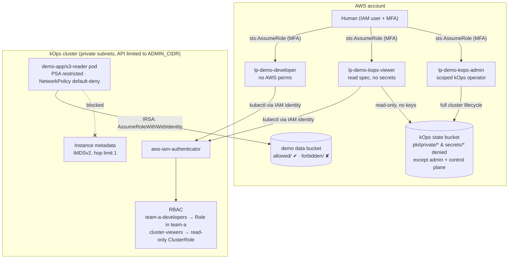

# kops-least-privilege

A hands-on demo of the **principle of least privilege** on AWS using
[kOps](https://kops.sigs.k8s.io/). Every identity in the stack — the human
operator, the cluster nodes, the in-cluster addons, the developers and the
application pods — gets exactly the permissions it needs and nothing more. A
verification script then *proves* it by attempting both allowed and forbidden
actions and checking that each one succeeds or fails as expected.

> **Cost warning:** creating the cluster launches real AWS resources
> (3× t3.medium, a NAT gateway, an NLB, EBS volumes). Expect roughly
> **$0.25–0.30/hour**. Tear it down when you are done (see [Cleanup](#cleanup)).

---

## Why this exists

The kOps getting-started guide asks you to create an IAM user with
`AmazonEC2FullAccess`, `IAMFullAccess`, `AmazonS3FullAccess`,
`AmazonVPCFullAccess`, `AmazonRoute53FullAccess`, `AmazonSQSFullAccess` and
`AmazonEventBridgeFullAccess`. That is fine for a first cluster, but `IAMFullAccess`
alone is equivalent to account admin. Out of the box, many clusters also let any
pod reach the node's instance metadata service and steal the node's IAM role,
and hand out long-lived admin kubeconfigs.

This repo shows how to tighten each of those layers and explains the reasoning
for every setting inline.

## The layers



| Layer | Default / common practice | This repo | Details |
|---|---|---|---|
| **Operator IAM** | `*FullAccess` managed policies | Scoped `lp-demo-kops-admin` role: IAM actions limited to `*.${CLUSTER_NAME}` role names, `iam:PassRole` only to EC2, S3 only on the kOps buckets, MFA required to assume | [docs/iam.md](docs/iam.md) |
| **State store** | Private bucket, anyone with S3 access can read CA keys | Bucket policy denies `pki/private/*` and `secrets/*` to everyone but the admin and control plane, enforces TLS + encryption | [docs/iam.md](docs/iam.md) |
| **Read-only persona** | n/a | `lp-demo-kops-viewer` can `kops get cluster` but cannot mint an admin kubeconfig | [docs/iam.md](docs/iam.md) |
| **Node IAM roles** | Node role carries permissions for CCM, EBS CSI, etc. | `useServiceAccountExternalPermissions: true` moves addon permissions to per-addon IRSA roles; node role shrinks | [docs/kops.md](docs/kops.md) |
| **Instance metadata** | Reachable from pods | IMDSv2 required, `httpPutResponseHopLimit: 1`, plus a NetworkPolicy deny to `169.254.169.254` | [docs/kops.md](docs/kops.md) |
| **Network exposure** | Public topology, SSH from `0.0.0.0/0` | Private subnets, no SSH key, no bastion, API restricted to `ADMIN_CIDR` | [docs/kops.md](docs/kops.md) |
| **Cluster admin creds** | Long-lived admin kubeconfig | `kops export kubeconfig --admin=1h`; day-to-day access goes through IAM-mapped identities | [docs/kops.md](docs/kops.md) |
| **Kubernetes authn/z** | Everyone shares admin | aws-iam-authenticator maps IAM roles → groups; namespaced RBAC with no `secrets`, `pods/exec`, or RBAC-write | [docs/kubernetes.md](docs/kubernetes.md) |
| **Workload AWS access** | Pods inherit the node role | IRSA: one pod, one role, `GetObject` on `allowed/*` only | [docs/kubernetes.md](docs/kubernetes.md) |
| **Pod hardening** | Privileged pods allowed | Pod Security Admission `restricted`; non-root, read-only rootfs, all caps dropped | [docs/kubernetes.md](docs/kubernetes.md) |
| **Pod network** | Allow-all | Default-deny ingress and egress (Cilium enforces it) | [docs/kubernetes.md](docs/kubernetes.md) |
| **CI** | — | GitHub Actions workflow runs with `permissions: contents: read` | [.github/workflows/lint.yml](.github/workflows/lint.yml) |

## Repository layout

```
.
├── config.env.example           # copy to config.env; every script sources it
├── iam/
│   ├── policies/                # IAM + bucket policy templates (envsubst placeholders)
│   └── trust/                   # MFA-required trust policy for the personas
├── kops/
│   ├── cluster.yaml             # Cluster + InstanceGroups, each setting commented with WHY
│   └── encryption-config.yaml   # secrets encryption at rest (key generated at runtime)
├── k8s/
│   ├── 00-namespaces.yaml       # PSA restricted
│   ├── 10-rbac-team-a.yaml      # developer Role/RoleBinding
│   ├── 11-rbac-cluster-viewers.yaml
│   ├── 20-demo-app.yaml         # IRSA workload that probes allowed/forbidden actions
│   └── 30-networkpolicies.yaml
├── scripts/
│   ├── 01-bootstrap-iam.sh      # buckets, personas, policies   (supports --dry-run)
│   ├── 02-create-cluster.sh     # kops create/update/validate   (supports --dry-run)
│   ├── 03-apply-k8s.sh          # namespaces, RBAC, demo app    (supports --dry-run)
│   ├── 04-verify-least-privilege.sh   # PASS/FAIL table of allowed vs denied actions
│   ├── 98-delete-cluster.sh
│   └── 99-teardown-iam.sh
└── docs/
    ├── iam.md
    ├── kops.md
    └── kubernetes.md
```

## Prerequisites

- An AWS account you can experiment in, and an IAM user **with MFA enabled**
  that has bootstrap rights (for step 1 only: creating IAM roles and S3 buckets)
- `aws` CLI v2, `kops` (≥ 1.30; written against 1.33–1.35), `kubectl`,
  `jq`, `envsubst` (`gettext-base` on Debian/Ubuntu, `gettext` on Homebrew)
- [`aws-iam-authenticator`](https://github.com/kubernetes-sigs/aws-iam-authenticator)
  for logging in as the developer/viewer personas

## Quick start

```bash
git clone https://github.com/toneyzhen/kops-least-privilege.git
```

```bash
cd kops-least-privilege && cp config.env.example config.env
```

Edit `config.env`: set `AWS_ACCOUNT_ID`, globally unique bucket names, and
`ADMIN_CIDR` to your public IP (`curl -s https://checkip.amazonaws.com`) with `/32`.

The setup scripts (01–03) accept `--dry-run`, which prints the rendered policies/manifests
and the commands it would run, without touching AWS. Start there:

```bash
./scripts/01-bootstrap-iam.sh --dry-run
```

**1. Bootstrap IAM and buckets** (run as your bootstrap IAM user, once):

```bash
./scripts/01-bootstrap-iam.sh
```

**2. Assume the scoped operator role and create the cluster.** From here on
you are *not* an administrator — kOps runs with only `lp-demo-kops-admin`:

```bash
eval "$(aws sts assume-role \
  --role-arn "arn:aws:iam::${AWS_ACCOUNT_ID}:role/lp-demo-kops-admin" \
  --role-session-name kops --serial-number "<your MFA device ARN>" --token-code <code> \
  --query 'Credentials.[AccessKeyId,SecretAccessKey,SessionToken]' --output text \
  | awk '{print "export AWS_ACCESS_KEY_ID="$1" AWS_SECRET_ACCESS_KEY="$2" AWS_SESSION_TOKEN="$3}')"
```

```bash
./scripts/02-create-cluster.sh
```

This takes ~10–15 minutes and ends by exporting an admin kubeconfig that
**expires in one hour**.

**3. Deploy namespaces, RBAC, network policies, and the IRSA demo app:**

```bash
./scripts/03-apply-k8s.sh
```

**4. Prove least privilege:**

```bash
./scripts/04-verify-least-privilege.sh --mfa-serial "<your MFA device ARN>" --mfa-code <code>
```

Use `--skip-aws` to run only the in-cluster checks.

## What the verifier proves

Each row is an action attempted by a specific identity, with the expected
outcome. The script exits non-zero if any row doesn't match.

| Identity | Action | Expected |
|---|---|---|
| developer (`team-a-developers`) | create deployments in `team-a` | ✅ allowed |
| developer | get secrets in `team-a` | ❌ denied |
| developer | `pods/exec` in `team-a` | ❌ denied |
| developer | create rolebindings (self-escalation) | ❌ denied |
| developer | list pods in `kube-system` | ❌ denied |
| developer | delete nodes | ❌ denied |
| viewer (`cluster-viewers`) | list pods in all namespaces | ✅ allowed |
| viewer | get secrets | ❌ denied |
| viewer | delete pods | ❌ denied |
| `demo-app/s3-reader` pod | identity is its own IRSA role, not the node role | ✅ |
| `demo-app/s3-reader` pod | read `s3://…/allowed/hello.txt` | ✅ allowed |
| `demo-app/s3-reader` pod | read `s3://…/forbidden/secret.txt` | ❌ AccessDenied |
| `demo-app/s3-reader` pod | reach instance metadata (`169.254.169.254`) | ❌ blocked |
| `lp-demo-kops-viewer` (AWS) | list the cluster's objects in the state store | ✅ allowed |
| `lp-demo-kops-viewer` (AWS) | read the cluster CA private key | ❌ denied |
| `lp-demo-kops-viewer` (AWS) | `iam:ListUsers` | ❌ denied |

## Logging in as a developer or viewer

The developer and viewer personas reach Kubernetes via aws-iam-authenticator,
not with certificates. After assuming `lp-demo-developer`, add a kubeconfig
user like:

```yaml
users:
  - name: developer
    user:
      exec:
        apiVersion: client.authentication.k8s.io/v1beta1
        command: aws-iam-authenticator
        args: ["token", "-i", "lp-demo.k8s.local"]
```

Then `kubectl -n team-a get pods` works and `kubectl -n team-a get secrets`
returns `Forbidden`.

## Cleanup

```bash
./scripts/98-delete-cluster.sh
```

```bash
./scripts/99-teardown-iam.sh
```

Run the first as `lp-demo-kops-admin`, the second as your bootstrap user.
Both ask for confirmation unless you pass `--yes`.

## Limitations and honest caveats

- **Not everything can be resource-scoped.** Many EC2 `Create*`/`Describe*`
  actions don't support resource-level permissions, so the operator policy
  still grants some of them on `*`. Destructive actions are tag-conditioned
  where AWS allows it. See the table in [docs/iam.md](docs/iam.md).
- **`iam:CreateRole` is inherently powerful.** It's restricted by role-name
  pattern and paired with a `PassedToService` condition on `iam:PassRole`. A
  permissions boundary would close the remaining gap; see the commented
  `permissionsBoundary` in `kops/cluster.yaml`.
- **The OIDC discovery bucket is public by design.** It holds only the
  discovery document and JWKS public keys, and the bucket policy limits public
  read to that prefix.
- **Validated offline, not against every kOps release.** CI checks that every
  policy and manifest renders and parses, and shellchecks all scripts. Settings
  that couldn't be confirmed against kOps docs are marked `NOTE (unverified)` in
  the files. Issues and PRs are welcome.
- **This is a demo, not a production baseline.** It is single-AZ with one
  control-plane node to keep costs down.

## License

[MIT](LICENSE)
